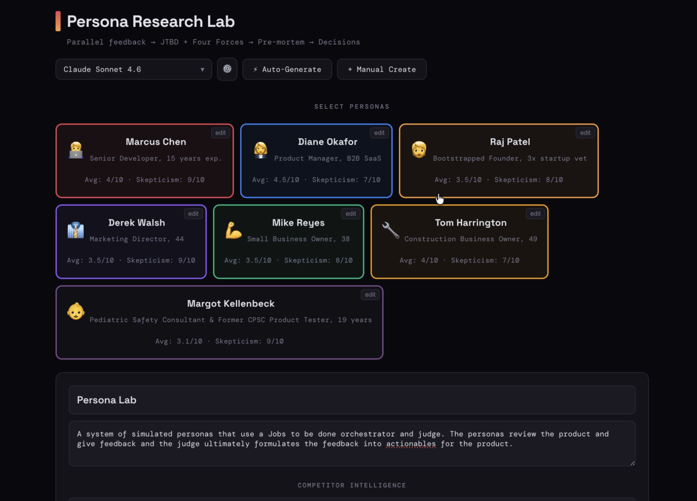

# Persona Lab

**Adversarial AI personas that stress-test product pitches before customers do.**

Describe a product, pick a lineup of skeptical personas — each with their own traits, scoring formulas, and pet peeves — and get back structured, unflattering feedback from every one. A second layer of synthesis agents then runs that critique through a Jobs-to-be-Done framework, a failure pre-mortem, and a product rewrite, producing a strategic dossier instead of a chatbot transcript.

> Built with React 19, Vite, and Supabase, orchestrating parallel calls to Claude + Gemini.



---

## The problem

Founders and PMs validate pitches against friendly audiences — teammates, early adopters, customers who already signed up. The brutal feedback comes later, from the people who *didn't* buy. Persona Lab surfaces that feedback up front.

Each persona has a baked-in bias profile ("Senior dev, burned by 3 dead platforms"), pet peeves ("vague pricing, buzzword marketing"), and a scoring formula that forces objections to be concrete and mathematically grounded — not generic "sounds great, needs more polish."

---

## Meet the adversarial personas

The app ships with a pack of generic adversaries — the lineup that savages most products:

- **Marcus Chen**, senior dev, 15 years. Burned by vendor lock-in. Rates most software 4/10 and considers a 7 genuine praise.
- **Diane Okafor**, B2B SaaS PM. Has lived through 15 failed tool rollouts. Asks "will my least technical teammate actually use this daily?"
- **Raj Patel**, 3x bootstrapped founder. Calculates ROI on every dollar. Suspicious of subscription pricing and anything without a free tier.

Persona packs are designed to be domain-specific — new personas can be AI-generated for any niche via `PERSONA_GEN_PROMPT` (`src/prompts/index.js:96`), which enforces adversarial calibration: high skepticism, low brand loyalty, industry-specific pet peeves.

Each persona also carries a **pedigree** block: `calibratedFrom`, `biasProfile`, and `blindSpot`. The reviewer can see *what the persona is good at critiquing and where their judgment is suspect*, so no single voice dominates the synthesis.

---

## The orchestrator pattern

```
   USER INPUT                      STAGE 1 — fan out               STAGE 2 — fan in
 ┌─────────────┐            ┌────────────────────────┐        ┌──────────────────────┐
 │ pitch       │            │ Persona 1  → JSON      │        │ JTBD synthesis       │
 │ competitors │   ───►     │ Persona 2  → JSON      │  ───►  │ (Christensen 4-force)│
 │ cynicism    │            │ Persona 3  → JSON      │        ├──────────────────────┤
 │ model       │            │ Persona N  → JSON      │        │ Pre-mortem           │
 └─────────────┘            │  (parallel, abort-safe)│        │ (failure analysis)   │
                            └────────────────────────┘        ├──────────────────────┤
                                                              │ Product rewrite      │
                                                              │ (sharpened pitch)    │
                                                              └──────────────────────┘
                                                                        │
                                                                        ▼
                                                              Auto-save → Supabase
                                                              Export   → PDF
```

**Stage 1 — fan out.** One Claude/Gemini call per selected persona, in parallel, each with a custom system prompt that puts the model "in character." Prompts are not just role-play: persona traits (skepticism, price-sensitivity, UX weight) are numerically injected, and buy-probability is computed inside the model's chain of thought via a persona-parameterized formula:

```
buyProbability = round((value + usability) / (priceConscious * skepticism) * 25)
// value, usability: model-produced ratings on 1–10
// priceConscious, skepticism: persona traits on 1–10
```

Every response is strict JSON — ratings, headline, review, dealbreakers, competitor comparisons, wishlist, unsolved pain points — so stage 2 can consume it machine-readably without re-parsing prose.

**Stage 2 — fan in.** Three synthesis agents each receive the full set of per-persona dossiers and produce distinct strategic outputs. They run in parallel to one another; none of them see each other's output, which keeps the three framings independent.

Orchestration lives in `src/App.jsx`, prompt construction in `src/prompts/index.js`, provider dispatch in `src/api/llm.js`. All three stages share a single `AbortController` — so one user click of "Stop" tears down the whole DAG cleanly, with no orphaned in-flight requests.

---

## Why Jobs-to-be-Done

Raw adversarial feedback is useful but noisy — N personas, each with their own axe, saying contradictory things. The user needs synthesis, not a wall of complaints.

Persona Lab uses **Clayton Christensen's Jobs-to-be-Done** framework (`JTBD_PROMPT` in `src/prompts/index.js:38`) because it's the right lens for *switching behavior*: why would a customer actually abandon their current solution for this one? The JTBD agent maps every persona's critique onto:

- **The Four Forces of switching** — *Push* (pain of the current state), *Pull* (appeal of this product), *Anxiety* (fear of adopting), *Habit* (inertia of staying). The right product beats push + pull against anxiety + habit.
- **Friction points** — where personas want contradictory things (e.g., Marcus wants depth, Diane wants her least technical teammate to be productive on day one). Explicit tradeoffs, not averaged-out mush.
- **Market gaps** — unmet needs that *no one in the competitive set solves well*. These are the actual white-space opportunities, grounded in evidence from the dossiers rather than vibes.
- **Switching cost** — a 1–10 score with rationale.
- **Validation questions** — what to actually ask real customers to confirm the synthesis holds in the wild.

The pre-mortem agent attacks from the opposite direction (*what kills this business in 12 months?*) using failure scenarios, a fatal-assumption call-out, and a survival condition. The rewrite agent then closes the loop with a sharpened pitch, repositioning statement, and per-persona messaging hooks — every recommendation grounded in specific feedback from stage 1, not generic advice.

---

## Engineering decisions worth reading the code for

**`src/prompts/index.js` — prompt engineering, not prompt copy-pasting.**
Persona traits are mathematically injected into the system prompt. Buy-probability is computed inside the model's chain of thought via a persona-parameterized formula. A global cynicism dial scales ratings up or down with explicit multipliers. Every prompt ends with a strict JSON schema and an "ONLY valid JSON" clause.

**`src/api/llm.js` — provider-agnostic surface over Anthropic and Google.**
One `callAPI({ modelId, system, userMessage, thinking, signal })` entry point dispatches to Claude or Gemini based on the selected model. Handles 429s via `retry-after`, respects `AbortSignal` so a user hitting Stop actually cancels in-flight requests, and unwraps provider-specific JSON shapes behind a shared `extractJSON` helper. Six models supported, including Claude's extended thinking.

**`src/db/schema.sql` — Postgres with row-level security, not just "I used Supabase."**
Three tables (`products`, `research_runs`, `persona_results`) with RLS policies that gate every row on `auth.uid() = user_id`. The `persona_results` policy is parent-scoped — access is granted by joining to the owning run — so compromising one anon JWT can never leak another user's data. The anon key is intentionally publishable because this pattern makes it safe.

**Browser-only architecture, deliberately.**
Users bring their own Anthropic / Gemini keys, stored in `localStorage` and sent directly to the provider from the browser. No backend proxy, no server-side key storage, no vendor cost exposure — keys are sent only to the model provider, never proxied through a Persona Lab server. The tradeoff: keys live in `localStorage`, which is acceptable for a BYO-key tool but would be wrong for a hosted service with managed credentials.

**Abort-safe orchestration.**
`stopResearch()` aborts the shared `AbortController`, clears per-persona loading state, and tears down the three synthesis flags in one shot — so a half-finished batch never leaves the UI stuck.

---

## Tech stack

| Layer | Choice | Why |
|---|---|---|
| UI | React 19 + Vite 8 | Fast HMR, modern React, native `AbortSignal` support in `fetch`. |
| AI | Anthropic Claude (Sonnet 4.6, Haiku 4.5), Google Gemini (3.1 Pro, 3 Flash, 2.5 Pro/Flash) | Multi-provider lets users pick cost vs quality; thinking models for synthesis steps. |
| Data | Supabase (Postgres + auth + RLS) | Row-level security replaces a backend for a browser-only app. |
| PDF | `@react-pdf/renderer` | Client-side export; no server round-trip for the feedback dossier. |
| Testing | Vitest + Testing Library | Unit tests on the pieces where a regression silently corrupts output: `llm.js`, `prompts/index.js`, `usePersonas.js`, shared components. |
| Build | Vite + bundled launchers | Minified builds packaged with `start-mac.command` / `start-windows.bat` so non-technical users can launch the app locally without a Node toolchain. Not a security boundary — the client is designed to be inspectable. |

---

## Running locally

**Prerequisites:** Node 20+, a Supabase project (optional — history saving is disabled without it), and at least one API key (Anthropic or Google).

```bash
git clone https://github.com/djfisher/persona-lab.git
cd persona-lab
npm install
cp .env.example .env.local   # fill in VITE_SUPABASE_URL + VITE_SUPABASE_ANON_KEY
npm run dev
```

Then open the app, go to Settings, and paste in your Anthropic or Gemini key. Keys live in `localStorage` only — nothing is sent anywhere but the provider.

**Supabase setup:** create a new project, open the SQL editor, run `src/db/schema.sql`. That creates the three tables and the RLS policies. Enable anonymous auth under Authentication → Providers.

**Try it without any API keys:** the welcome modal has a "See how it works with an example" button that loads a fully populated research dossier — useful for exploring the UI and the synthesis output without burning tokens.

**Scripts:**
```
npm run dev        # dev server
npm run build      # production build (obfuscated)
npm test           # vitest run
npm run coverage   # vitest with v8 coverage
npm run deploy     # gh-pages publish of dist/
```

---

## Project structure

```
src/
├── App.jsx                    # orchestration + top-level state
├── api/llm.js                 # provider-agnostic LLM client
├── prompts/index.js           # all system prompts + persona formula
├── personas/
│   ├── defaultPersonas.js     # generic adversarial persona pack
│   └── usePersonas.js         # persona CRUD + persistence
├── components/
│   ├── Common.jsx             # shared UI primitives
│   ├── HistoryStrip.jsx       # saved-run selector
│   ├── ProductSelector.jsx    # per-product scoping
│   └── panels/                # one panel per synthesis stage
├── hooks/
│   ├── useAuth.js             # Supabase anonymous auth
│   ├── useHistory.js          # saveRun → research_runs + persona_results
│   ├── useProducts.js         # product CRUD
│   ├── useResearchPipeline.js # fan-out → fan-in orchestrator (reducer-backed)
│   └── useRunHistory.js       # run list + rehydration
├── db/schema.sql              # Postgres + RLS
├── lib/supabase.js            # client init
├── data/exampleData.js        # demo dossier for the welcome flow
└── FeedbackPDF.jsx            # @react-pdf export
```

---

## What's next

Honest about what this isn't yet, and where I'd take it:

- **Jira / Linear / Kanban integration.** Every JTBD job, friction point, market gap, and persona dealbreaker already lands as structured JSON. One-click export to a project management board — push jobs as epics, dealbreakers as bugs, market gaps as opportunities — closes the loop between "we found the problem" and "it's on the sprint." Persona context (who raised it, why, their blind spot) goes in the ticket description.
- **Automatic issue prioritization.** The pipeline already produces priority signals the UI doesn't fully exploit: buy-probability deltas across personas, switching-cost score, how many personas converged on the same dealbreaker, and the demand rating on each market gap. A prioritization pass could rank exported issues by a combined score (persona-convergence × severity × market-gap demand) so the output is a ranked backlog, not an unsorted dump.
- **Prompt eval harness.** Prompt quality is validated manually right now. The natural next step is a scored eval set against reference critiques — same product, same personas, track drift as prompts change.
- **TypeScript.** JS was fast to iterate in; the LLM response shapes and persona schemas are the natural place to start adding types.
- **Streaming.** Current flow is request-response per persona. Streaming per-token feedback would materially improve perceived latency on the fan-out step.

---

## License

Released under the [MIT License](./LICENSE) — free for personal and commercial use, including derivative works. Copyright © 2026 Dan Fisher.

If you fork this or build on the orchestrator / persona-generation patterns, attribution is appreciated but not required. Issues and pull requests welcome.
